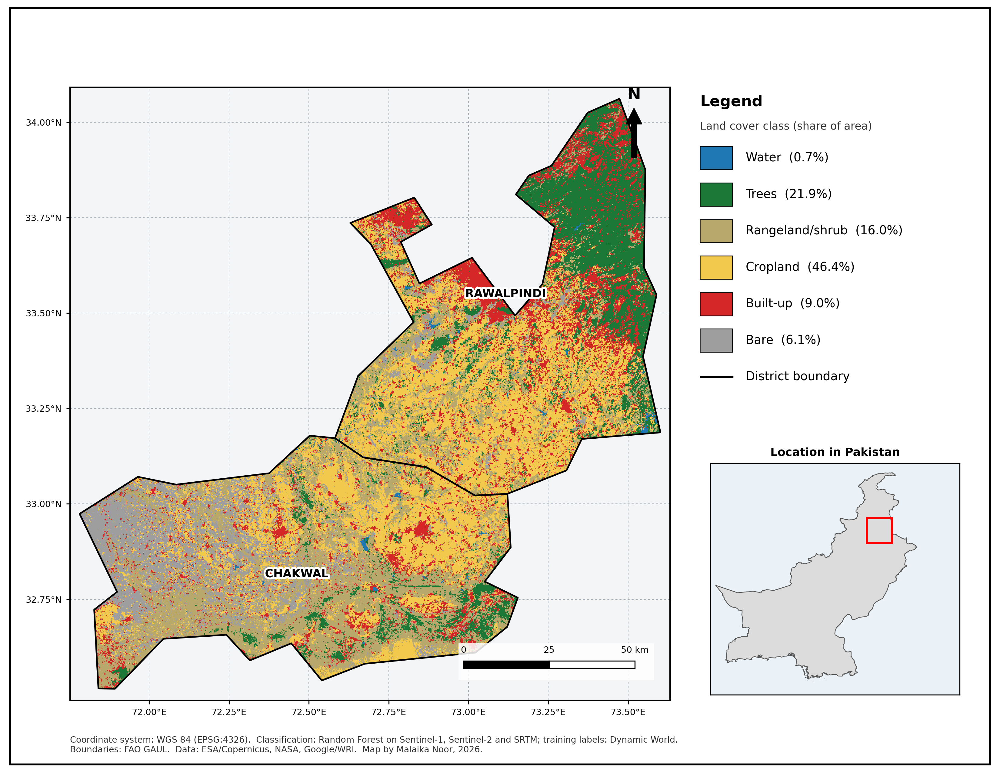
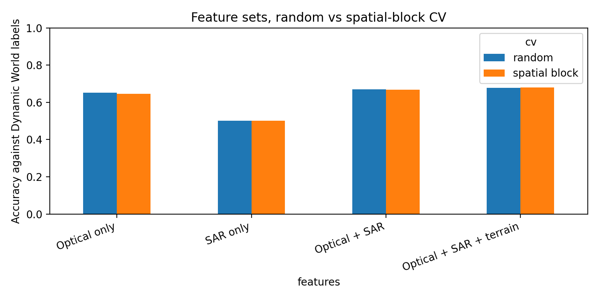
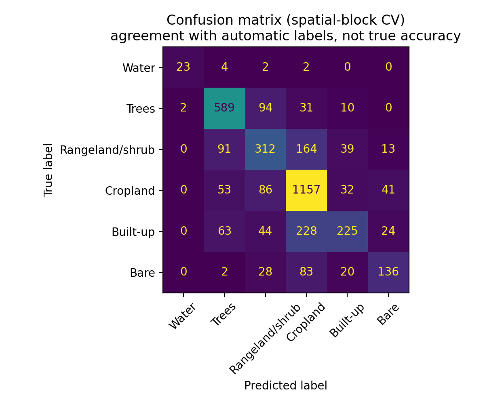
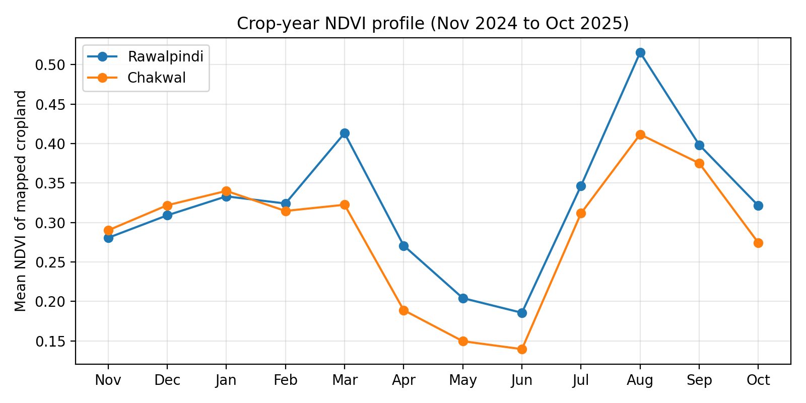

# Cropland and Cropping-Season Mapping, Chakwal and Rawalpindi (crop year 2024-25)

A multi-sensor (Sentinel-2 optical + Sentinel-1 radar + terrain) Random Forest workflow in Google Earth Engine and Python. It maps land cover and cropland across two districts of northern Punjab, Pakistan (about 12,400 km² of boundary polygons), estimates areas with uncertainty, and checks accuracy against points labelled by hand on high-resolution imagery.

**Main question:** how much cropland is there, how is it used across seasons, and how far can the numbers be trusted?

## Summary

- Cropland is the largest land-cover class. The map shows about 46% of the area as cropland. After correcting for classification error with independent validation points, the estimate is **52.0% ± 7.7%** (about 6,448 ± 954 km²).
- Against 114 hand-labelled points (cropland vs not cropland), the map has an overall accuracy of 77.9%, a user's accuracy of 82.1% and a producer's accuracy of 73.3%. It under-detects cropland.
- Adding Sentinel-1 radar and terrain to Sentinel-2 improves agreement with the automatic labels modestly (accuracy 0.645 to 0.679 under spatial-block cross-validation).
- Cropping-season results are exploratory. Kharif-only cropland is the largest class (about 38 to 39% of mapped cropland) and is stable across NDVI thresholds. The split between double-cropped and fallow land depends strongly on the threshold.

## Maps and figures

### Land-cover map, 2024-25

*Legend: blue = water, dark green = trees, tan = rangeland/shrub, yellow = cropland, red = built-up, grey = bare. This image comes from a separate Earth Engine Random Forest trained on up to 300 points per class (see Method, step 9). The area numbers in this README come from out-of-fold predictions at the random points, not from this image.*

### Feature sets, random vs spatial-block cross-validation

*Agreement with Dynamic World labels. Higher is better.*

### Confusion matrix (agreement with automatic labels, not true accuracy)

*Rows are Dynamic World labels, columns are predictions (spatial-block cross-validation, best feature set). Built-up land is often predicted as cropland, and rangeland/shrub is also confused with cropland.*

### Crop-year NDVI profile of mapped cropland

*Mean NDVI of points mapped as cropland. Both districts peak in August (monsoon season). Rawalpindi also shows a smaller peak in March.*

## Key results

| Result | Value |
| --- | --- |
| Sample size | 3,598 random points (about 1,800 per district) |
| Best feature set | Optical + SAR + terrain (accuracy 0.679, cropland F1 0.763, spatial-block CV) |
| Mapped cropland | 46.4% of the area, about 5,757 km² (95% CI ± 202 km², sampling error only) |
| **Error-adjusted cropland** | **52.0% ± 7.7%, about 6,448 ± 954 km²** (corrected using the independent validation) |
| Independent validation (114 points, cropland vs not) | Overall accuracy 77.9%, user's accuracy 82.1%, producer's accuracy 73.3% |

**Why the two cropland estimates differ.** The mapped share (46.4%) counts what the model predicts. The validation points show that the model misses about a quarter of true cropland (producer's accuracy 73.3%), so the error-adjusted estimate (52.0%) is higher. The adjusted figure has a wide interval (± 7.7 percentage points) because the validation sample is small. In the validation, cropland means an agricultural field, either cultivated or fallow with visible field boundaries. The training labels (Dynamic World "crops") describe growing crop vegetation, so the two definitions are not identical, which may contribute to the difference.

Accuracy figures follow the area-weighted estimator of Olofsson et al. (2014). They are point estimates from a small sample.

### Sensor comparison (agreement with Dynamic World labels)

| Features | Random CV accuracy | Spatial-block CV accuracy | Cropland F1 (spatial) |
| --- | --- | --- | --- |
| Optical only | 0.651 | 0.645 | 0.728 |
| SAR only | 0.501 | 0.501 | 0.659 |
| Optical + SAR | 0.669 | 0.667 | 0.754 |
| Optical + SAR + terrain | 0.678 | 0.679 | 0.763 |

What this shows:

- Random and spatial-block cross-validation give almost identical scores, so there is no sign that spatial autocorrelation between neighbouring points inflates the results. The points are sparse (about one every 2 km on average), which also makes this unlikely.
- Radar alone is weak. Adding radar to optical data improves accuracy by about two points, and terrain adds about one more.

What it does not show:

- These differences are small and were not tested for statistical significance.
- The labels (Dynamic World) are themselves derived from optical imagery, which favours optical features. This comparison therefore cannot show which sensor is truly better for mapping cropland.

### Land cover (both districts, from the random sample)

| Class | Share | Area (km²) | 95% CI (km²) |
| --- | --- | --- | --- |
| Cropland | 46.4% | 5,757 | ± 202 |
| Trees | 21.9% | 2,722 | ± 161 |
| Rangeland/shrub | 16.0% | 1,979 | ± 147 |
| Built-up | 9.0% | 1,111 | ± 115 |
| Bare | 6.1% | 751 | ± 97 |
| Water | 0.7% | 86 | ± 33 |

These intervals reflect sampling error only. Only the cropland class was checked and adjusted with independent validation. The other classes are agreement-based estimates and should be treated as approximate (for example, the confusion matrix shows that built-up land is often predicted as cropland).

### Cropping seasons (exploratory, NDVI-threshold based)

Share of mapped cropland, with a sensitivity test on the NDVI threshold (rabi = December to April, kharif = July to October):

| Season class | NDVI 0.40 | NDVI 0.45 | NDVI 0.50 |
| --- | --- | --- | --- |
| Fallow / not sown | 15.9% | 23.6% | 33.1% |
| Rabi only (winter) | 13.9% | 14.0% | 13.0% |
| Kharif only (summer) | 37.7% | 38.9% | 38.2% |
| Double cropped | 32.5% | 23.5% | 15.7% |

The kharif-only and rabi-only shares are stable across thresholds. The split between double-cropped and fallow land depends strongly on the threshold, so treat the season results as indicative, not validated. About one in five points mapped as cropland may not be cropland (user's accuracy 82.1%), and some monsoon greenness may come from grass rather than crops, so these shares are probably contaminated by misclassified land.

## Method

1. **Study area:** Chakwal and Rawalpindi districts (FAO GAUL boundaries, geoBoundaries as fallback). The area (about 12,400 km²) is computed from these polygons and may differ slightly from official district areas.
2. **Features (November 2024 to October 2025):** monthly Sentinel-2 NDVI (Cloud Score+ masking, gaps filled with the annual median), annual Sentinel-2 bands and NDBI/MNDWI, Sentinel-1 VV/VH medians for rabi and kharif, SRTM elevation and slope.
3. **Labels:** Dynamic World yearly mode, merged to six classes (water, trees, rangeland/shrub, cropland, built-up, bare).
4. **Sampling:** simple random points in each district (about 1,800 each), features extracted at 20 m.
5. **Model:** Random Forest (300 trees, balanced class weights) in scikit-learn, compared across four feature sets with random 5-fold and spatial-block (about 5 km) 5-fold cross-validation.
6. **Area estimation:** class proportions from out-of-fold predictions at the random points, scaled to district area, with 95% confidence intervals.
7. **Independent validation:** 120 points (60 mapped
